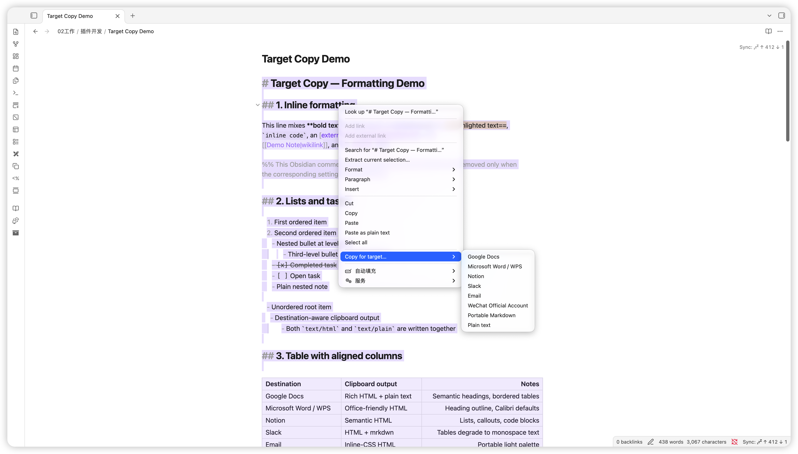
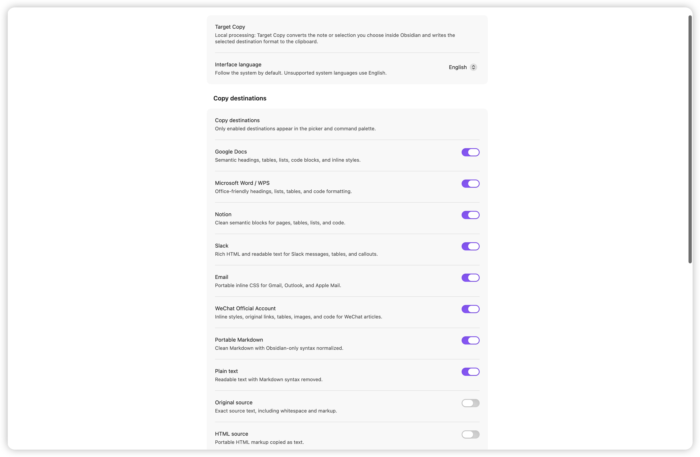
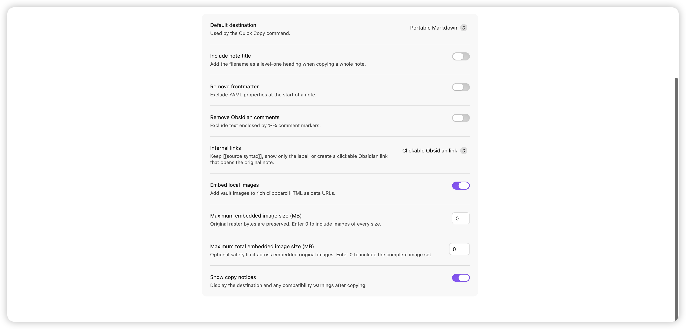
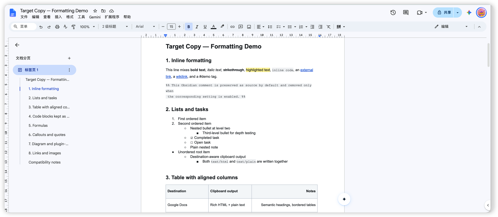

# Target Copy

> **Language: English · [切换到简体中文 →](README.zh-CN.md)**
> [繁體中文](README.zh-TW.md) · [日本語](README.ja.md) · [Deutsch](README.de.md)

Copy an Obsidian selection or note in a format tailored for the app where it
will be pasted. Every conversion runs locally inside Obsidian.

> Target Copy 1.0.0 is the current open-source desktop release.

## Why destination-aware copying?

Google Docs, Microsoft Word, Slack, and email clients interpret clipboard data
in different ways. Target Copy asks for the destination and
adapts the surrounding HTML while preserving the user's source, content, links,
images, and code by default. Destination-specific handling appears as a
compatibility note after copying.

## Destinations

| Destination | Clipboard output | Important behavior |
| --- | --- | --- |
| Google Docs | Rich HTML + plain text | Semantic headings, bordered tables, nested lists, inline styles |
| Microsoft Word / WPS | Office-friendly HTML + plain text | Heading outline metadata, Calibri defaults, tables and code blocks |
| Notion | Semantic HTML + plain text | Clean pages, lists, tables, callouts, and code blocks |
| Slack | Lightweight HTML + plain text | Tables use aligned monospace text in both representations |
| Email | Inline-CSS HTML + plain text | Portable light palette for Gmail, Outlook, and Apple Mail |
| WeChat Official Account | Fully inline HTML + plain text | Mobile typography with original links, images, and source code preserved |
| Portable Markdown | Plain text | Standard Markdown with clickable Obsidian links for wikilinks |
| Plain text | Plain text | Readable headings, lists, tables, blockquotes, and code |
| Original source (optional) | Plain text | Exact source, including whitespace, properties, and markup |
| HTML source (optional) | Plain text | Portable HTML markup with inline styles |

All rich targets write both `text/html` and `text/plain`, allowing the receiving
application to choose its preferred representation. Slack receives readable text
when the editor uses the plain-text clipboard representation.

## Source and output formats

The source export destinations can be enabled in settings. Original source copies
editor selections or whole Markdown/HTML files exactly. For an exact source
selection, use the editor; Reading view supplies rendered content.

| Input | Portable Markdown output |
| --- | --- |
| Markdown containing a fenced HTML example | The complete fenced code example |
| Markdown containing raw HTML | The original HTML, as supported by Markdown |
| HTML file or Reading view selection | Markdown headings, links, emphasis, lists, tasks, and simple tables |
| Merged/nested tables, SVG, audio, video, or complex HTML | HTML preserving the structure and resource references |

Clickable wikilinks use `obsidian://` and open the original vault. Recipients need
access to that vault to follow them. The destination editor controls support for
these links; Google Docs may retain only their labels and styling. The plain-text
clipboard representation includes the complete link address.

Portable Markdown represents highlighted text with inline `<mark>` elements.

## Current features

- Copy a selection in Edit, Live Preview, or Reading view; copy the whole note when nothing is selected.
- Hover **Copy for target…** in editor and file context menus to open the enabled
  destinations as a native submenu, then select one to copy immediately.
- Open the destination picker from the ribbon or command palette, or bind a
  hotkey to each destination.
- Choose which destinations appear in the picker and command palette.
- Use a fixed default destination for Quick Copy or explicitly repeat the last-used destination.
- Follow the system language or choose English, Simplified Chinese, Traditional
  Chinese, Japanese, or German. English covers other system languages.
- Preserve YAML frontmatter, Obsidian comments, formulas, and fenced code by
  default. Wikilinks become clickable Obsidian links; settings can instead keep
  `[[source syntax]]` or visible text only.
- Keep Mermaid, Dataview, Tasks, PlantUML, Graphviz, and every other fenced block
  as editable source.
- Embed local vault images as data URLs.
- Keep LaTeX and diagram source editable.
- Preserve SVG and Canvas markup for rich targets; text targets receive their
  serialized source; Markdown retains SVG markup. Canvas portability is reported for each destination.
- Keep ordinary raster image bytes unchanged, with optional user-configured
  per-image and total safety limits.
- Preserve external links in WeChat output and report WeChat-specific link handling.

## Screenshots

### Choose a destination from the context menu

Hover **Copy for target…** to open the enabled destinations, then choose one to
copy immediately.



### Keep the destination list focused

Enable only the apps and formats used in your workflow. The picker, context
menu, and command palette show the same enabled destinations.



### Control what is carried to the destination

Set the default destination, title, internal-link behavior, local-image
embedding, image limits, and copy notifications.



### Paste into Google Docs

The copied content retains headings, inline formatting, lists, task states,
tables, links, and source blocks in Google Docs.



## Copy controls

The picker shows whether it will copy a selection or the whole document, the
source format, and each destination's clipboard format. Destinations keep a
stable order, with a marker on the last-used target.

In **Settings → Target Copy → Advanced settings**:

- **Menu order** arranges enabled destinations in menus and the picker.
- **Destination preferences** sets title inclusion, internal links, and local
  image embedding for individual destinations. Each option can follow the general setting.
- **Embedded notes** sets expansion count and nesting depth. Both default to `0`
  for unlimited expansion. Circular or unavailable references remain visible in
  the output and are listed in copy details.

Editor selections include the reference-link and footnote definitions they use.
Original source remains an exact copy of the selected text.

Long-running conversions offer a **Cancel copy** button and command. The
**Last copy details** command shows all compatibility notices from the latest
successful copy. Copy-progress and compatibility notifications have separate settings.

## Local processing

Every conversion runs inside Obsidian. Target Copy processes the selection or
note chosen by the user, expands referenced local Markdown notes, resolves vault images when image embedding
is enabled, and writes the destination format to the system clipboard. Remote
image references remain URLs for the destination editor to handle.

## Manual installation

1. Run `npm ci` and `npm run build` in this directory.
2. Create `<your-vault>/.obsidian/plugins/target-copy/`.
3. Copy `main.js`, `manifest.json`, and `styles.css` into that directory.
4. Reload Obsidian, open **Settings → Community plugins**, and enable
   **Target Copy**.

The release archive contains exactly those three installable files.

## Commands

The picker, Quick Copy, and Repeat Last commands are always available. Dedicated
destination commands are registered only for destinations enabled in settings,
so the command palette stays compact.

- `Target Copy: Copy for target…`
- `Target Copy: Quick copy using the default target`
- `Target Copy: Repeat the last copy target`
- `Target Copy: Cancel copy` while a conversion is running
- `Target Copy: Last copy details`
- `Target Copy: Copy for …` for each enabled destination

## Compatibility notes

- Slack receives rich HTML plus readable plain text for its message editor.
- Mermaid, SVG, Dataview, Excalidraw, and other plugin syntax is preserved as
  editable source for the destination application to render.
- Version 1.0.0 targets Obsidian Desktop and its desktop clipboard implementation.
- Word and WPS receive Office-friendly HTML; the receiving editor controls its final layout.
- The WeChat editor may re-upload pasted images. Always confirm every image in
  the editor before publishing.

## Development

```sh
npm ci
npm run check
```

`npm run dev` starts an esbuild watcher. Release archives package the generated
`main.js` with `manifest.json` and `styles.css`.

The conversion pipeline is:

```text
selection or note
  → source cleanup
  → Obsidian MarkdownRenderer
  → semantic DOM normalization
  → destination adapter
  → text/html + text/plain clipboard bundle
```

See [the architecture](docs/ARCHITECTURE.md) and
[dependency and license notes](docs/DEPENDENCIES.md).

## Open source

The complete plugin source, tests, translations, public documentation, build
scripts, and public CI configuration are published under the
[MIT License](LICENSE). The plugin is a self-contained local Obsidian runtime.
The production bundle uses Obsidian and its desktop clipboard bridge as host APIs;
build and test tools are documented separately.

- Read [CONTRIBUTING.md](CONTRIBUTING.md) before opening a pull request.
- Report vulnerabilities privately as described in [SECURITY.md](SECURITY.md).
- Use [SUPPORT.md](SUPPORT.md) for safe bug-reporting guidance.

## License

[MIT](LICENSE)
