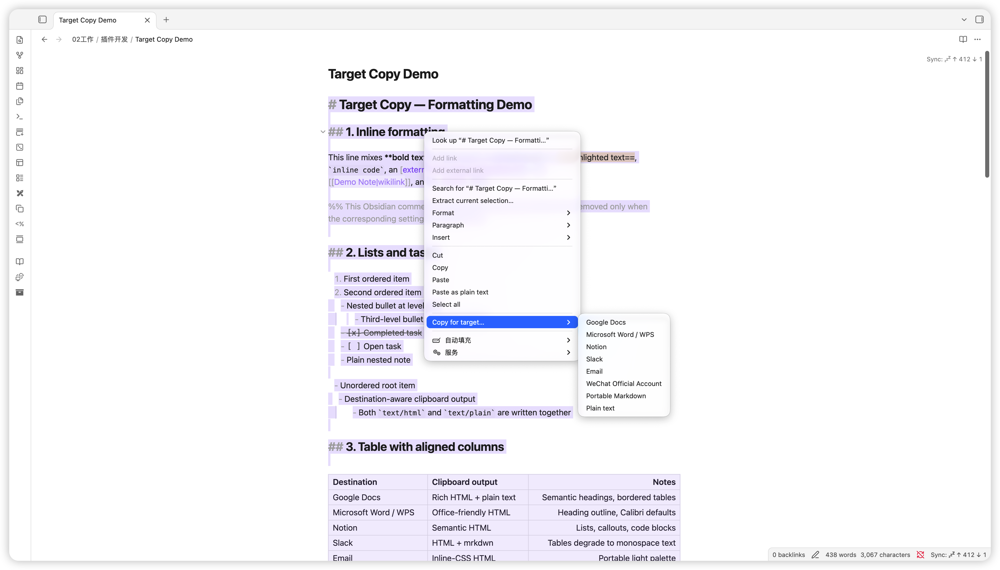
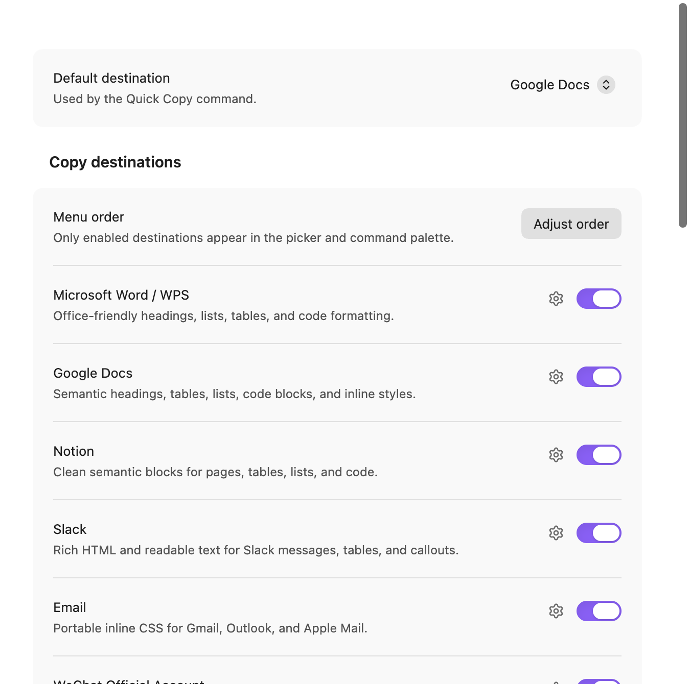
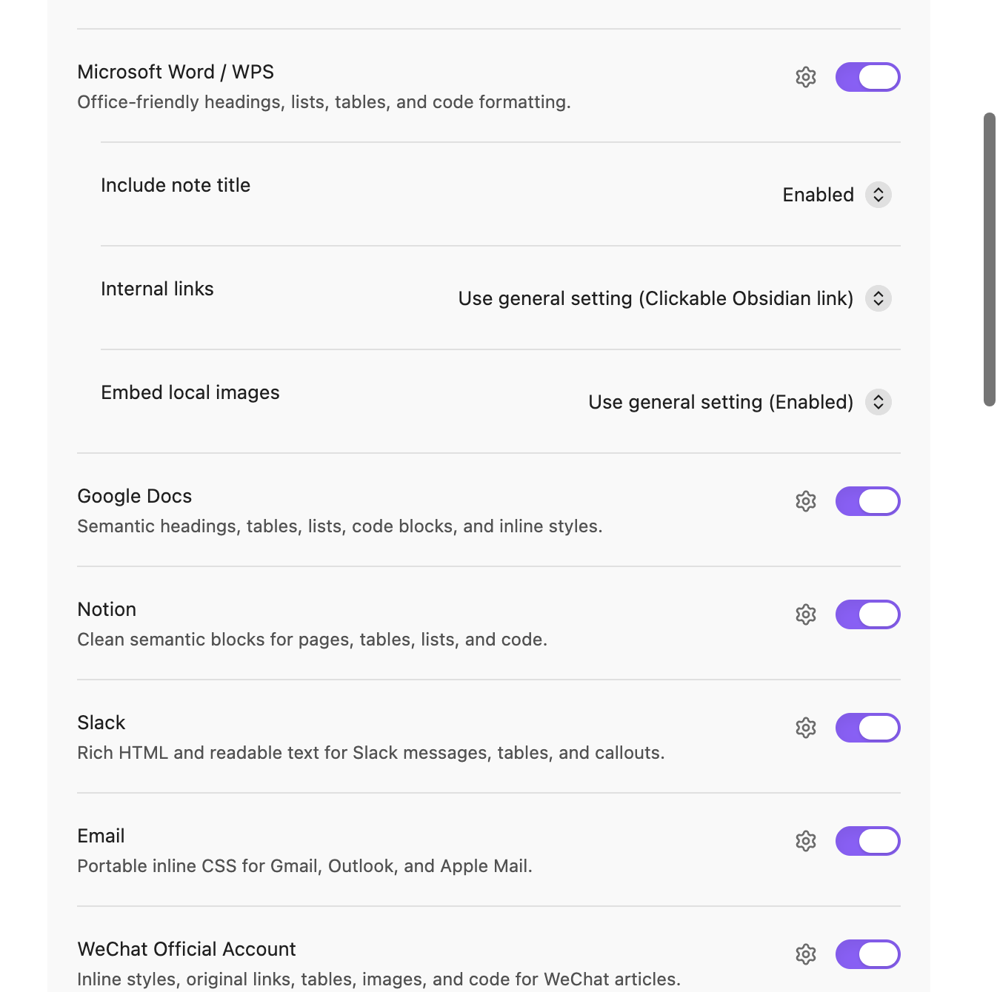
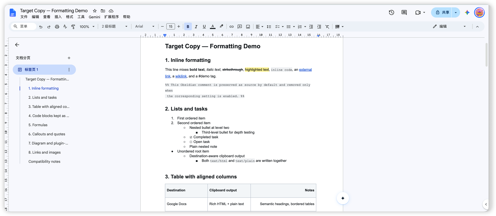

# Target Copy

> **语言：简体中文 · [Switch to English →](README.md)**
> [繁體中文](README.zh-TW.md) · [日本語](README.ja.md) · [Deutsch](README.de.md)

Target Copy 根据“准备粘贴到哪里”生成不同的剪贴板内容。所有转换均在
Obsidian 本地完成。

> 1.0.1 是当前完全开源的桌面端正式版本。

想了解它为什么被做出来、又如何服务于日常写作，可以阅读
[Target Copy：让写好的内容好好走到下一处](https://blog.tanjialin.com/posts/68421)。

## 第一版支持

| 目标 | 输出 | 处理方式 |
| --- | --- | --- |
| Google Docs | 富文本 HTML + 纯文本 | 语义标题、表格、嵌套列表、代码块、内联样式 |
| Microsoft Word / WPS | Office 兼容 HTML + 纯文本 | 标题大纲信息、列表、表格和代码块 |
| Notion | 语义 HTML + 纯文本 | 页面、列表、表格、提示框和代码块 |
| Slack | 轻量 HTML + 纯文本 | 表格输出为对齐的等宽文本 |
| Email | 内联 CSS HTML + 纯文本 | 适合 Gmail、Outlook、Apple Mail 的浅色样式 |
| 微信公众号 | 全内联 HTML + 纯文本 | 移动端排版，原样保留链接、图片和源码 |
| Portable Markdown | 纯文本 | 通用 Markdown，并将双链转换为可点击的 Obsidian 链接 |
| Plain text | 纯文本 | 去掉 Markdown 符号，保留可读的标题、列表和表格结构 |
| 原始源码（可选） | 纯文本 | 逐字保留源文本、空白、文档属性和语法 |
| HTML 源码（可选） | 纯文本 | 包含内联样式的可移植 HTML 代码 |

编辑、实时预览和阅读模式均支持选区；空选区自动复制全文。在编辑器或文件右键菜单中，
将指针停在“选择复制目标…”上即可展开已启用目标，点击目标后直接复制。工具栏和命令面板
可以打开目标选择窗口，也可以使用独立命令、快捷键或重复使用上一次目标。

设置中可以只启用自己常用的目标；被关闭的目标会同时从选择窗口和命令面板消失。界面支持
英语、简体中文、繁体中文、日语和德语，默认跟随系统；其他系统语言使用英语。语言和目标
开关均即时生效。

## 界面预览

### 右键选择目标

将指针停在“选择复制目标…”上即可打开已启用的目标，点击目标后立即复制。



### 只保留常用目标

在设置中启用需要的应用和格式；选择窗口、右键菜单和命令面板会使用同一份目标列表。



### 配置复制内容

可设置默认目标、标题、内部链接、本地图片嵌入、图片上限和复制提示。



### 粘贴到 Google Docs

Google Docs 中保留标题、行内格式、列表、任务状态、表格、链接和源码块。



## 输入与输出格式

源码目标可在设置中按需启用。原始源码支持编辑器选区或整篇 Markdown/HTML 文件；
需要逐字复制选区源码时，请使用编辑视图。阅读视图提供的是渲染后的选区内容。

| 输入 | 选择 Portable Markdown 后的输出 |
| --- | --- |
| 围栏代码块中的 HTML | 完整保留代码块 |
| Markdown 中的原生 HTML | 保留 Markdown 支持的原生 HTML |
| HTML 文件或阅读视图选区 | 标题、链接、强调、列表、任务和简单表格转换为 Markdown |
| 合并/嵌套表格、SVG、音视频等复杂结构 | 保留 HTML 结构与资源引用 |

可点击双链使用 `obsidian://` 打开原 Vault，接收者需要能够访问对应的 Vault。链接是否可点击取决于目标编辑器；Google Docs 可能只保留名称和样式。纯文本剪贴板包含完整的链接地址。

Portable Markdown 使用内联 `<mark>` 标签保留文字高亮。

## 复制与高级设置

选择窗口会显示选区或全文、来源格式，以及各目标的剪贴板格式。目标顺序保持固定，
上一次使用的目标带有标记。

在“设置 → Target Copy → 高级设置”中，可以：

- 调整已启用目标在菜单和选择窗口中的顺序。
- 为每个目标单独设置标题、内部链接和本地图片嵌入，也可以沿用通用设置。
- 设置嵌入笔记的展开数量和嵌套深度；默认 `0` 表示不限。循环引用或无法展开的引用
  会保留在输出中，并在复制详情中列出。

复制编辑器选区时，会带上其中使用的引用式链接与脚注定义。“原始源码”逐字复制选区文本。
较长的转换可以通过“取消复制”按钮或命令停止。“上次复制详情”命令展示最近一次成功复制的
完整兼容性提示。复制进度提示与兼容性提示可以分别开关。

## 本地处理

Target Copy 在 Obsidian 内处理用户选择的笔记或选区，根据设置解析其中引用的 Vault 图片，
并将目标格式写入系统剪贴板。外部图片保留原 URL，由目标编辑器按自身规则处理。

## 手动安装

1. 在本目录运行 `npm ci` 和 `npm run build`。
2. 新建 `<你的 Vault>/.obsidian/plugins/target-copy/`。
3. 将 `main.js`、`manifest.json`、`styles.css` 复制进去。
4. 重载 Obsidian，在“设置 → 第三方插件”中启用 Target Copy。

发行压缩包中只包含上述三个安装文件。

插件默认保留 YAML、Obsidian 注释、公式和所有代码块，并将双链转换为点击后打开
原 Vault 笔记的 Obsidian 链接；设置中也可改为保留 `[[原始语法]]` 或仅显示名称。
LaTeX、Mermaid、PlantUML、Graphviz、Dataview、Tasks 与 SVG 保留可编辑源码，
富文本中的 SVG/Canvas 保留原 DOM，纯文本目标输出序列化源码，Markdown 保留 SVG 标记。
普通 PNG/JPEG/WebP 保持原始字节，并提供可选的单图与总量安全上限。
表格保留完整单元格内容，用户自带的安全 HTML 属性和内联样式也会保留。
微信公众号外链保持原样，只提示目标编辑器可能有限制。

## 开源与贡献

插件的完整 TypeScript 源码、测试、五语言翻译、公开文档、构建脚本和公开 CI 配置均以
[MIT 许可证](LICENSE)公开。生产包调用 Obsidian API 及其桌面剪贴板桥接，
插件作为 Obsidian 内的完整本地运行模块工作。开发与构建依赖的许可证见
[依赖与许可证说明](docs/DEPENDENCIES.md)。

- 开发和提交代码前请阅读[贡献指南](CONTRIBUTING.md)与[架构说明](docs/ARCHITECTURE.md)。
- 安全漏洞请按[安全政策](SECURITY.md)私下报告，不要公开私人笔记或利用细节。
- 普通问题与 Bug 报告请先阅读[支持说明](SUPPORT.md)。

开发者可运行：

```sh
npm ci
npm run check
```

## 兼容性说明

- Slack 消息编辑器接收富文本 HTML 和可读的纯文本。
- Excalidraw、Dataview 等第三方内容以可编辑源码交给目标应用处理。
- 1.0.1 面向 Obsidian 桌面端及其桌面剪贴板。
- Word 与 WPS 接收 Office 兼容 HTML，最终布局由目标编辑器决定。
- 微信公众号后台会按自身规则处理粘贴图片，发布前请逐张确认。

公开技术说明见[架构说明](docs/ARCHITECTURE.md)与
[依赖和许可证说明](docs/DEPENDENCIES.md)。
