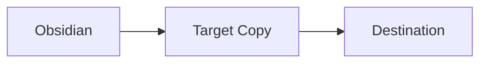

# Compatibility fixture

This paragraph contains **bold**, *italic*, ~~strikethrough~~, ==highlight==,
`inline code`, an [external link](https://example.com), and [[Internal note|an internal link]].

This source paragraph wraps
onto another Markdown line but remains one paragraph after pasting.\
This explicit hard break remains a line break.

WeChat link check: [公众号旧文](https://mp.weixin.qq.com/s/example) and
[ordinary external reference](https://example.com/reference).

## Lists

1. First item
2. Second item
   - Nested item
     - Third-level item for WeChat degradation testing
   - [x] Completed task
   - [ ] Open task

## Table

| Element | Presentation | Notes |
| --- | ---: | --- |
| Heading | Semantic | Clear hierarchy |
| Table | Aligned | Borders and spacing |

## Code

```ts
export const localOnly = true;
export const destination = "Target Copy";
```

## Formula and diagram

Inline formula: $E = mc^2$.

$$
\int_0^1 x^2\,dx = \frac{1}{3}
$$



> [!warning] Compatibility warning
> Unsupported content should degrade visibly, never disappear silently.

> A regular blockquote with two lines.
> The second line remains quoted.

---

Local image fixture: ![[fixture.svg|Fixture image]]

%% This comment must be preserved by default and removed only when explicitly configured. %%
